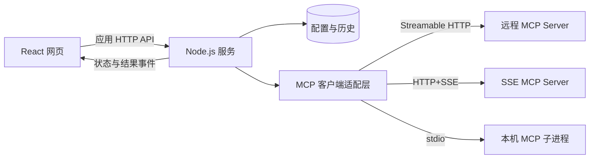

# MCP Web Client 功能需求文档

> 状态：待评审草案 v0.2  
> 日期：2026-10-22  
> 目标：先明确功能、交互、版本范围和验收标准，再开始编码。本文的优先级与默认值为建议方案。

> 实现进度（2026-10-22）：已进入第一阶段开发，完成 SSE／Streamable HTTP 连接、指定工具调用及结果展示；已增加多服务配置增删改查、本机持久化、刷新恢复、JSON 格式化和浅色工作台。当前每个浏览器会话仅保持一个活跃连接，配置及凭据使用明文 JSON 保存，Token 在界面默认隐藏并提供显示切换。实际版本为 Node.js 26.12.1、React 19.3.1、SDK 1.32.1；已实测协议 2025-11-25。本文其余功能仍是规划，2026-07-28 协议兼容尚未实现。运行及验证说明见 [README](../README.md)。

## 1. 产品定位

开发一个基于 React 的网页 MCP 客户端，让用户通过界面配置 MCP Server、发现其能力、填写参数、执行调用并查看结果。

首版定位为面向开发者的可视化调试工具，形成以下闭环：

**添加服务器 → 建立连接 → 浏览功能 → 填写参数 → 执行 → 查看结果与历史 → 修改参数再次执行。**

手动调用不依赖大模型，也不需要配置模型 API Key。AI 对话与自动选择工具作为后续独立能力。

### 1.1 目标用户与场景

| 用户 | 场景 | 预期结果 |
| --- | --- | --- |
| MCP 服务开发者 | 验证自己开发的服务 | 确认能力发现、参数校验、返回内容和错误处理符合预期 |
| MCP 使用者 | 连接已有服务并调用功能 | 无需编写客户端代码即可完成操作 |
| 集成开发者 | 对比多个服务器的接口行为 | 保存连接配置，复用参数，定位请求和响应问题 |

### 1.2 默认范围

- 首版面向单用户、本机运行，浏览器访问本机 Node.js 服务。
- 可以配置多个 MCP Server，并保留多个独立连接上下文。
- 首版必须同时支持 SSE（HTTP+SSE）和 Streamable HTTP，保留 stdio 支持。
- 主要适配桌面浏览器，默认中文界面，协议字段和工具名称保持原文。
- 首版交付工具调用、资源读取、提示词获取三类核心能力。
- 团队账户、权限分配、公网托管、工作流编排、MCP 服务市场不纳入首版。

## 2. 技术与运行边界

### 2.1 技术基线

| 项目 | 建议选型 | 说明 |
| --- | --- | --- |
| 页面 | React + TypeScript | 官方版本页当前列出的最新版本为 React 19.3；开工时锁定具体稳定版本 |
| 前端构建 | Vite | 单页应用，无首版服务端渲染需求 |
| 服务端 | 最新正式发布的 Node.js Current + TypeScript | 本次核对到的版本为 v26.12.0，发布于 2026-10-14；不采用 nightly 或 RC |
| 服务端框架 | Fastify，建议 | 提供页面所需接口、事件推送和运行管理；最终随技术验证确定 |
| MCP 接入 | 官方 TypeScript SDK | 根据稳定 SDK 的实际协议支持锁版本，不手写整套协议 |
| 数据存储 | SQLite，建议 | 保存配置、调用历史、参数预设；运行中的连接对象只放内存 |
| 前后端通信 | HTTP API + SSE 事件流 | 用于客户端自身的操作与状态推送，与 MCP 的传输方式分别设计 |

Node.js 的 Current 与 LTS 是不同发布渠道。本项目按“最新 Node.js”的要求选 Current，并通过版本文件、依赖锁文件及 CI 固定实际版本，避免每次启动自动升级。版本依据：[Node.js 官方发布记录](https://github.com/nodejs/node/releases/tag/v26.12.0)、[React 官方版本页](https://react.dev/versions)。

### 2.2 架构

- React 负责交互、表单、结果展示，不负责启动本机进程。
- Node.js 负责 MCP 通信、连接生命周期、凭据使用和持久化。
- stdio 的“本机”指 Node.js 服务所在机器；如果部署到服务器，启动的进程也在服务器上，不能直接操作访问者电脑。
- 浏览器刷新后恢复当前状态和未结束的调用，不重复发送原调用。
- Node.js 重启后恢复配置；旧调用标记为“已中断／结果未知”，不自动补发。

### 2.3 协议版本策略

本次核对时，官方 `latest` 指向 **2026-07-28**。该版本采用无状态请求和逐请求能力信息，不能把所有服务都按旧版 `initialize` 会话模型实现。[官方规范](https://modelcontextprotocol.io/specification/2026-07-28)、[传输及版本兼容说明](https://modelcontextprotocol.io/specification/2026-07-28/basic/transports)。

- 目标支持 2026-07-28，并兼容 2025-11-25；具体组合在开工阶段用稳定 SDK 做验证。
- 产品界面的“连接”统一表示服务可用状态及本地运行上下文，不强制等同于协议长连接。
- 通过适配层处理不同版本的初始化、请求元数据、事件、取消及结果差异。
- 连接详情显示实际协议版本；不支持的版本明确报错，不能静默伪装兼容。
- SSE（HTTP+SSE）和 Streamable HTTP 均为 P0 必需功能，由用户明确选择；401/403 不触发传输切换。
- SSE 使用该传输对应的兼容协议版本，不要求每种传输都支持所有协议版本；兼容矩阵分别记录并验证。
- 不默认承诺所有扩展；没有实现的客户端能力不得对服务端宣告支持。
- 稳定 SDK 对目标版本的支持是开发前置验证项；若不满足，先修订兼容矩阵，再进入功能开发，不在需求阶段声称已兼容。

## 3. 功能优先级

P0 表示首版必须交付，P1 表示核心闭环完成后的增强，P2 表示后续扩展。

| 编号 | 模块 | 范围 | 优先级 |
| --- | --- | --- | --- |
| F01 | 连接配置 | 新增、编辑、删除、复制、搜索 | P0 |
| F02 | 连接执行 | SSE、Streamable HTTP、stdio、状态和重连 | P0 |
| F03 | 基础认证 | 无认证、Bearer Token、自定义 Header、stdio 环境变量 | P0 |
| F04 | 工具调用 | 列表、参数表单、JSON 编辑、执行、结果查看 | P0 |
| F05 | 资源读取 | 列表、URI 模板、读取、预览与下载 | P0 |
| F06 | 提示词 | 列表、参数填写、获取消息 | P0 |
| F07 | 调用可观测性 | 状态、耗时、错误、协议日志、进度与取消 | P0 |
| F08 | 本地数据 | 配置持久化、历史记录、重新填充参数 | P0 |
| F09 | 使用体验 | 空状态、加载、失败反馈、键盘操作 | P0 |
| F10 | OAuth | 浏览器授权、回调、刷新与退出授权 | P1 |
| F11 | 配置迁移 | JSON 导入导出、兼容常见 `mcpServers` 格式 | P1 |
| F12 | 调试增强 | 参数预设、收藏、结果比较、资源订阅 | P1 |
| F13 | 交互补充 | 用户信息补充请求、参数补全 | P1 |
| F14 | SSE 接入 | HTTP+SSE 连接、消息发送、事件接收与断线处理 | P0 |
| F15 | AI 对话 | 模型配置、工具选择、对话与执行轨迹 | P2 |
| F16 | 扩展能力 | Tasks、MCP Apps、其他协商扩展 | P2 |

## 4. 详细功能

### 4.1 服务器配置与连接（F01–F03）

服务器列表显示名称、传输方式、状态和最近一次成功使用时间。支持按名称搜索，并切换当前服务器。

| 配置项 | 适用范围 | 规则 |
| --- | --- | --- |
| 名称 | 全部 | 必填，用于展示；内部使用独立 `serverId` |
| 描述 | 全部 | 可选 |
| 传输方式 | 全部 | 首版提供 SSE、Streamable HTTP、stdio；配置值分别为 `sse`、`streamable-http`、`stdio` |
| Endpoint URL | HTTP | 必填；SSE 填写 SSE 入口，Streamable HTTP 填写 MCP 端点；不根据路径猜测协议 |
| 认证方式 | HTTP | 无认证、Bearer Token、自定义 Header |
| Header 列表 | HTTP | 键值编辑，敏感值遮罩；禁止覆盖由 SDK 管理的协议头 |
| command | stdio | 可执行文件名称或路径；独立于参数填写 |
| args | stdio | 按数组项填写，保留带空格参数的边界 |
| cwd | stdio | 可选，指 Node.js 所在机器上的工作目录 |
| env | stdio | 键值编辑，敏感值遮罩；仅传入必要环境变量 |
| 连接超时 | 全部 | 默认 15 秒，可调整 |
| 调用超时 | 全部 | 默认 60 秒，可按调用覆盖；限制范围在设置中明确 |
| 凭据保存 | 全部 | 随服务配置保存，Token 默认隐藏，可切换显示 |

交互规则：

1. “保存”只保存配置，不启动进程或发送业务调用。
2. “测试连接”验证协议交互及能力发现，显示服务器名称、版本、协议版本、支持能力和耗时。
3. 测试 stdio 会启动配置的命令，按钮附近必须明确展示该行为；测试结束清理测试实例。
4. “连接”建立供工作台使用的运行上下文；重复点击不创建重复实例。
5. 多服务器互不影响；不能因为一个服务器失败而清空其他服务器结果。
6. “断开”释放该连接的资源与自有子进程；有执行中调用时展示影响并让用户选择。
7. 修改地址、凭据、命令后，旧连接标记为配置已变化，重新连接后才应用新配置。
8. 认证错误展示“凭据无效／权限不足”，网络错误展示失败阶段；不将所有错误显示为“连接失败”。

两种 HTTP 传输的接入要求：

| 传输方式 | 配置与通信行为 | 首版要求 |
| --- | --- | --- |
| SSE（HTTP+SSE） | 连接用户填写的 SSE 入口，由 SDK 处理服务端公布的消息发送端点及事件接收 | 支持能力发现、工具调用、资源读取、提示词获取、认证、断开与重连 |
| Streamable HTTP | 连接用户填写的 MCP 端点，由 SDK 处理 HTTP 请求以及 JSON／SSE 响应 | 支持同样的核心操作，并验证普通 JSON 响应和 SSE 流式响应 |

SSE 是独立的 MCP 传输选项，不能以“Streamable HTTP 支持 SSE 响应”代替 HTTP+SSE 接入。连接详情显示实际选择的传输；失败时保留原配置并提示原因，不自动切换。SSE 的消息发送端点需要校验目标地址，跨源地址不得自动继承凭据。[官方 SDK 传输说明](https://ts.sdk.modelcontextprotocol.io/client)。

连接状态：`未连接 → 连接中 → 可用`，以及 `需要认证 / 重连中 / 失败 / 已断开`。断线可以有限重试连接，但任何业务工具调用都不自动重放。

### 4.2 能力发现与目录

- 按 Tools、Resources、Prompts 分组，显示数量、搜索框和刷新按钮。
- 区分“不支持该能力”“支持但列表为空”“加载失败”，分别给出提示。
- 列表支持协议游标分页；切换服务器时不复用其他服务器的游标。
- 同名工具使用 `serverId + toolName` 区分，界面显示所属服务器。
- 显示工具与资源的名称、标题、说明及原始元数据。
- P0 提供手动刷新；P1 在服务器和协议支持时接收列表变更通知并更新目录。
- 能力列表缓存必须与服务器、协议及授权上下文绑定；凭据变化后失效。

### 4.3 工具调用（F04）

选择工具后展示说明、输入 Schema、可选输出 Schema 及服务端提供的行为提示。

参数编辑提供两种模式：

| 模式 | 行为 |
| --- | --- |
| 表单模式 | 根据 Schema 生成字段，支持字符串、数字、整数、布尔、枚举、对象、数组、必填和默认值 |
| JSON 模式 | 编辑完整参数对象，支持格式化、语法检查和错误定位 |

- 两种模式共享同一参数值；切换不得丢失未被表单支持的字段。
- 复杂组合 Schema、递归结构等无法可靠生成表单时，切换 JSON 编辑并说明原因，仍保留完整校验。
- 区分字段未填写、空字符串、`null`、`false` 和 `0`，不自动混为一类。
- 前后端均验证参数；错误定位到字段，验证失败时不发送请求。
- 初始值可以使用 Schema 中明确提供的默认值，不凭空生成真实业务参数。
- 执行按钮展示当前服务器和工具，发送前保留参数快照。
- 单次执行过程中防止重复点击；用户仍可在其他调用页运行不同任务。
- 修改类调用的确认规则由本地策略决定；服务端 annotations 作为提示，不能视为安全保证。
- 执行后保留参数和结果，支持修改参数再次执行。

工具列表及调用对应 `tools/list`、`tools/call`；工具结果可能包含结构化内容及多个内容块。[Tools 规范](https://modelcontextprotocol.io/specification/2026-07-28/server/tools)。

### 4.4 结果展示

| 结果类型 | 展示要求 |
| --- | --- |
| 文本 | 保留换行，复制；Markdown 仅通过安全渲染器展示 |
| JSON／structuredContent | 折叠树与原始 JSON 切换；支持复制和下载 |
| 图片 | 按支持的 MIME 类型预览，展示尺寸或大小；不支持则下载 |
| 音频 | 支持的格式可手动播放，不自动播放 |
| 资源链接／嵌入资源 | 展示 URI、类型和名称，明确区分“通过 MCP 读取”和“打开网页” |
| 未知内容类型 | 显示类型和原始数据，不导致整页崩溃 |
| 工具错误 | 保留错误结果及内容，明确标记失败 |

- 保持内容块原始顺序，不只取第一个文本字段。
- 单独显示执行耗时、结果大小、运行编号及终态。
- 输出 Schema 校验失败时保留原始结果，标记“输出不符合 Schema”，不静默丢弃内容。
- HTTP 200 不等于成功；需分别检查传输、协议错误和工具 `isError`。
- 遇到非终态结果，例如需要用户补充输入，不能显示“执行成功”；首版未支持时明确提示能力限制。
- 展示经过脱敏的原始响应，便于排查渲染结果与服务端内容是否一致。

### 4.5 资源读取（F05）

- 展示资源名称、URI、说明、MIME 类型及可用的大小信息。
- 支持浏览资源列表、手动填写 URI、选择资源模板并输入变量。
- 使用标准 URI Template 规则展开模板，读取前显示最终 URI。
- 读取后复用结果展示组件，支持文本、JSON、图片和二进制下载。
- 一次读取返回多个内容项时逐项展示。
- 支持重新读取；P1 增加订阅／取消订阅以及更新时间提示。
- `file://` 等 URI 属于 MCP Server 的资源空间，不能据此直接读取网页客户端机器文件。

对应 `resources/list`、`resources/templates/list`、`resources/read`；订阅机制按实际协议版本实现。[Resources 规范](https://modelcontextprotocol.io/specification/2026-07-28/server/resources)。

### 4.6 提示词获取（F06）

- 展示提示词名称、说明及参数。
- 根据服务端声明填写参数，校验必填项。
- 获取后按角色、顺序和内容块展示消息，支持复制完整消息 JSON。
- 明确按钮是“获取提示词”，获取成功不代表已调用大模型。
- 首版不自动发送提示词到外部模型；P2 可支持用户主动带入 AI 对话。

对应 `prompts/list`、`prompts/get`；使用官方 SDK 对应的客户端能力。[官方 SDK 客户端说明](https://ts.sdk.modelcontextprotocol.io/client)。

### 4.7 运行状态、进度与取消（F07）

- 每次业务操作生成应用级 `runId`，关联底层协议请求编号。
- 调用状态包含：等待执行、执行中、等待用户输入、成功、失败、取消请求已发送、已取消、超时、已中断／结果未知。
- 服务端提供进度时显示进度与消息；未提供时只显示运行时间，不虚构百分比。
- 取消按协议版本及传输支持执行；不能保证服务端已停止时显示“停止等待，服务端结果未知”。
- 超时、取消和断线都不表示业务操作已经回滚；界面保留查询结果或人工重试入口。
- 将重连与业务重试分开；重试必须由用户显式触发，并生成新的运行记录。
- 应用内事件流断开后，先向后端查询运行状态，再恢复展示，不重新调用工具。

错误至少区分：配置无效、进程启动失败、网络／TLS、认证、协议不兼容、能力不支持、参数无效、JSON-RPC 错误、工具业务错误、超时、结果解析失败。

调试面板支持按连接、调用和级别过滤日志。记录请求方法、方向、时间、耗时及脱敏内容；stdio 的 stderr 单独显示，不混入协议 stdout。

### 4.8 配置与历史（F08）

- 保存服务器配置；页面刷新、服务重启后可以重新载入。
- 历史记录包含服务器快照、操作类型、工具名称或 URI、脱敏参数、状态、时间、耗时、结果摘要和错误信息。
- 默认保留最近 500 条记录或 30 天，以先达到的清理条件为准；支持调整和手动清空。
- 原始请求／结果默认仅当前运行保留；用户可开启本地完整历史，界面说明参数和结果可能包含业务数据。
- 密码、认证 Header、Token 和环境变量中的秘密值不进入日志与历史。
- 点击历史可查看详情或“填入工作台”；缺少的敏感参数需要重新填写，不能点击历史即自动执行。
- 删除服务器配置时提示是否一并删除历史；保留历史时展示名称快照和“配置已删除”。

### 4.9 后续增强（F10–F16）

| 功能 | 细化范围 | 边界 |
| --- | --- | --- |
| OAuth | 发现授权信息、跳转授权、校验回调、保存与刷新凭据、退出授权 | 首版仅支持手动凭据；OAuth-only 服务在 P0 明确提示暂不支持 |
| 配置导入导出 | JSON 格式版本、字段校验、重复名称处理、导入预览 | 默认不导出秘密；导入 stdio 配置不自动执行 |
| 参数预设 | 命名保存、更新、删除、绑定工具 | 工具 Schema 变化后重新校验 |
| 结果比较 | 对比两次运行的结构化结果、状态和耗时 | 不将顺序差异自动认定为业务错误 |
| 用户补充输入 | 支持表单输入、接受、拒绝、取消，关联原调用 | 按协议版本处理，未完成前不标记调用成功 |
| 参数补全 | 在服务支持时补全提示词和资源模板参数 | 不把任意工具字段都假定为支持协议补全 |
| AI 对话 | 模型配置、工具选择、调用审批、执行轨迹、上下文管理 | 另立需求；明确数据将发送给哪个模型提供方 |
| MCP 扩展 | 长任务、交互式应用等 | 按扩展单独实现与验收，不默认支持 |

## 5. 页面与核心流程

### 5.1 页面布局

| 区域 | 内容 |
| --- | --- |
| 左侧导航 | 服务器列表、新增连接、历史、设置 |
| 顶部状态栏 | 当前服务器、运行位置、传输方式、连接状态、连接／断开 |
| 工作区左栏 | Tools／Resources／Prompts 标签、搜索、列表 |
| 工作区右栏 | 当前能力说明、参数表单／JSON、执行按钮、结果 |
| 底部可折叠面板 | 当前调用状态、日志、脱敏请求与响应 |

另提供连接编辑抽屉、服务器详情、历史详情。空页面引导用户创建连接；失败时保留输入。状态不能只靠颜色区分，关键操作支持键盘和明确焦点。

### 5.2 远程服务首次调用

1. 点击“添加服务器”，选择 SSE 或 Streamable HTTP，填写名称、对应入口 URL 和凭据。
2. 测试连接，查看服务身份、能力和协议版本。
3. 保存并连接，进入 Tools 列表。
4. 选择工具，填写参数并执行。
5. 查看真实结果、耗时及状态；修改参数后再次调用。
6. 在历史中找到这两次调用并重新填充参数。

### 5.3 stdio 服务首次调用

1. 选择 stdio，填写命令、参数数组、工作目录和必要环境变量。
2. 页面展示执行位置和完整命令参数预览。
3. 用户点击连接，Node.js 启动子进程并验证 MCP 交互。
4. 发现能力并执行调用；启动失败时显示路径或 stderr 错误。
5. 断开后释放由本应用启动的进程与资源。

## 6. 数据与模块设计边界

此处只明确责任，不提前固定完整接口或数据库 Schema。

| 对象／模块 | 职责 |
| --- | --- |
| `ServerConfig` | 保存名称、传输配置、超时、凭据引用及配置版本 |
| `CredentialStore` | 凭据随本机配置保存，编辑时按需回填，默认隐藏 Token |
| `ConnectionRuntime` | 管理运行状态、适配器、子进程、实际协议及能力 |
| `CapabilityCatalog` | 按授权上下文缓存能力列表及游标 |
| `Invocation` | 保存操作快照、状态、时间、结果和错误 |
| `ProtocolAdapter` | 屏蔽新旧协议及传输的差异 |
| `EventBridge` | 将运行状态和日志关联到正确的页面与调用 |

应用 API 应覆盖配置增删改查、连接／断开／状态、能力列表、工具调用、资源读取、提示词获取、运行查询／取消、历史查询与删除。后台只接受受支持的操作，不提供任意 URL 代理或任意 JSON-RPC 转发入口。

## 7. 运行与非功能要求

### 7.1 本机运行边界

- 首版默认监听回环地址；只接受受信任的 Host、Origin 和应用会话，防止外部网页调用本机执行接口。
- stdio 使用命令与参数数组启动，不将整段输入交给 shell；只清理由本应用拥有的子进程。
- 私有网络 MCP 可由用户显式配置；自动重定向不能把凭据发送到其他目标，云元数据等敏感目标应受限制。
- 按当前用户要求，凭据明文保存在本机配置文件；文件限当前账户读写，页面提供 Token 隐藏／显示按钮。
- 页面以不可信内容处理服务器说明及响应，不执行返回的 HTML／脚本，不自动访问响应内的 URL。
- 如果未来开放局域网或公网访问，必须先补齐用户认证、连接归属、网络访问策略和进程隔离，再启用共享访问。

### 7.2 容量与体验目标

- 首版目标：10 个已配置服务器、5 个活跃服务器上下文、5 个并发调用；超出并发上限时排队并可取消排队。
- 服务端每个调用限制响应累计大小，建议默认 20 MiB；超限明确失败或中止，不能仅在前端截断而后台无限接收。
- 默认内联预览最多 1 MiB 文本，较大结果提供下载；列表和日志采用分页或虚拟滚动。
- 用户操作后 200 ms 内出现加载或运行反馈；服务器耗时单独展示，不作为页面自身性能指标。
- 浏览器目标为验收时的 Chrome、Edge、Safari 最新稳定版；记录实际测试版本。
- 配置、日志和历史提供容量上限与清理入口。

以上数值是首版验收目标，需在实现后测量，当前不代表已经达到。

## 8. 首版验收标准

使用可控 MCP 测试服务构造正常、错误与边界结果，再分别使用实际 SSE、Streamable HTTP 和 stdio 服务验证。两个远程传输可以由同一服务的不同端点提供，但必须分别完成调用验证。成功必须检查响应内容，不能只检查 HTTP 状态。

| 编号 | 场景 | 通过标准 |
| --- | --- | --- |
| AC01 | 两种远程传输 | SSE 和 Streamable HTTP 分别连接成功，正确显示身份、协议和能力，并分别验证工具调用、资源读取和提示词获取；Streamable HTTP 覆盖 JSON 与 SSE 响应 |
| AC02 | 连接 stdio | 子进程启动、真实工具调用成功；断开后自有进程得到清理 |
| AC03 | 多服务器 | 两个服务器有同名工具时，参数和结果始终归属正确服务器 |
| AC04 | 参数校验 | 字符串、数值、布尔、数组、嵌套对象及无参数工具可用；非法输入不发请求 |
| AC05 | JSON 编辑 | 复杂 Schema 可用 JSON 输入；模式切换不丢字段 |
| AC06 | 结果渲染 | 多内容块、结构化结果、图片和未知类型均可查看，原始信息可追溯 |
| AC07 | 错误判断 | HTTP 成功但工具返回错误时显示失败；协议与网络错误可区分 |
| AC08 | 资源与提示词 | 实际读取资源和模板实例；获取的提示词消息内容、角色和顺序正确 |
| AC09 | 超时与取消 | 前端结束等待，状态准确；不自动重放，不声称远端必然停止 |
| AC10 | 刷新与重启 | 页面刷新恢复运行状态；Node.js 重启后配置保留，旧调用不会重复执行 |
| AC11 | 认证隔离 | 正确凭据成功、错误凭据失败；修改凭据后不再复用旧能力缓存 |
| AC12 | 历史脱敏 | 历史可检索、重填、删除；秘密值不出现在日志、响应接口和导出中 |
| AC13 | 分页与空状态 | 能读取后续页；空列表、能力不支持和加载失败显示不同状态 |
| AC14 | 版本与传输兼容 | 对公布支持的协议／传输组合逐项实测；SSE 与 Streamable HTTP 均验证认证失败、断线和重连，不自动重放业务调用；不支持的组合给出明确提示 |
| AC15 | 运行边界 | 外部来源请求被拒绝；返回 HTML 不执行；结果超限有明确反馈 |

## 9. 实施顺序

1. **技术验证**：固定 Node.js／React／SDK 版本，分别实测 SSE、Streamable HTTP 和 stdio 及其适用协议，形成兼容矩阵。
2. **连接与工具闭环**：完成工作台、连接配置、能力发现、参数编辑、真实工具调用和结果展示。
3. **补齐 P0**：资源、提示词、历史、日志、取消、脱敏及容量限制，逐项完成 AC01–AC15。
4. **增强版**：OAuth、导入导出、预设、补全、订阅和用户补充输入。
5. **后续版本**：根据实际使用需求单独设计 AI 对话、团队共享和扩展能力。

## 10. 评审时需要确认的产品选择

以下采用本文默认方案继续细化即可，不阻塞当前文档交付：

| 问题 | 本文默认方案 | 如果调整，影响什么 |
| --- | --- | --- |
| 首版主要用于本机还是共享服务器？ | 本机单用户 | 共享部署需提前增加账户、隔离与访问控制 |
| 是否必须接入 OAuth-only 服务？ | OAuth 为 P1 | 如必须，将 F10 提升为 P0 |
| 是否需要 AI 对话调用工具？ | 先手动调用，AI 为 P2 | 如需要，增加模型、成本、上下文与调用权限设计 |
| HTTP 传输范围 | 已确认：SSE 与 Streamable HTTP 均为 P0 | 两种传输分别实现并验收 |
| 是否默认持久化完整业务结果？ | 默认仅保存脱敏历史摘要 | 如需完整保留，应确定保存时间和容量 |

## 11. 参考资料与证据范围

- [Node.js v26.12.0 官方发布记录](https://github.com/nodejs/node/releases/tag/v26.12.0)
- [React 官方版本页](https://react.dev/versions)
- [MCP 2026-07-28 规范](https://modelcontextprotocol.io/specification/2026-07-28)
- [MCP 传输与向后兼容](https://modelcontextprotocol.io/specification/2026-07-28/basic/transports)
- [MCP Tools](https://modelcontextprotocol.io/specification/2026-07-28/server/tools)
- [MCP Resources](https://modelcontextprotocol.io/specification/2026-07-28/server/resources)
- [官方 TypeScript SDK v1 客户端文档](https://ts.sdk.modelcontextprotocol.io/client)

官方 SDK v1 文档用于核对现有客户端能力和传输类型，不能据此推断其已实现最新版协议。最初草案基于官方资料核对；当前已完成第一阶段的实际协议调用验证，证据与未实现范围以顶部实现进度及 README 为准，不能将规划的全部验收项视为已通过。
